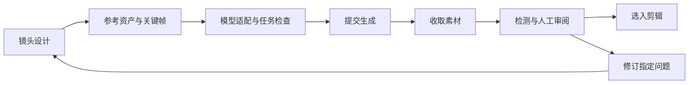

# 开源 AI 短剧平台构想与第一版范围

记录日期：2026-10-26。

本文保存关于“从一个 idea 到一个剧集”的开源平台讨论，作为后续产品设计、数据结构和工作流设计的基础。当前内容是初步方向与建议，尚未确定技术栈、开源许可证或具体开发排期。

**产品定位**

一个支持人和 AI 共同创作、可以追踪和局部重做的开源短剧制作平台。借鉴 ComfyUI 的可组合工作流，同时提供面向创作者的剧本、资产、分镜和剪辑工作台。

“从 idea 到剧集”是完整目标。用户也可以带着已有小说、剧本、人物图或部分视频，从中间任意阶段进入。

平台需要同时解决三个问题：镜头如何拍、资产如何保持一致、失败后如何只返工必要的部分。

**一、创作者提出的初始流程**

1. 输入由想法产生的故事梗概，或者已有小说。
2. 使用 skill 和大模型，将输入发展为 N 集剧情脚本。
3. 生成通用资源的提示词，包括时代背景、人物和其他规约。
4. 生成关键首尾帧和每一集的视频生成提示词。
5. 结合关键帧和视频提示词，生成视频片段。
6. 剪辑、AI 配音、添加字幕、人工审核。
7. 完成作品，准备上线。

**二、补充后的制作流程**

| 阶段 | 工作内容 | 交付成果 |
|---|---|---|
| 1. 输入与开发 | 接收想法、梗概或小说；确定改编范围、题材、受众、制作形式 | 创作简报、原著分析、改编方向 |
| 2. 系列规划 | 确定人物关系、故事主线、各集冲突与结尾钩子 | 故事设定、分集大纲 |
| 3. 单集剧本 | 写场景、动作、对白，检查节奏和可制作性 | 可拍摄剧本 |
| 4. 视觉与声音开发 | 确定画风、时代、角色外观、场景、道具、音色 | 设定资料、实际参考图、声音样本 |
| 5. 场面调度与分镜 | 决定谁在哪里、如何移动、摄影机拍哪里、何时切镜 | 场景站位、分镜、连续性要求 |
| 6. 动态预演 | 用分镜图、临时配音和简单剪辑检查剧情与节奏 | 可播放的低成本预演片 |
| 7. 镜头生成准备 | 选择生成模型与方式，准备参考图、关键帧、动作提示词 | 可执行的镜头任务 |
| 8. 媒体生产与挑选 | 生成图片、视频、配音、音效，比较候选，局部返工 | 被选用的素材及其版本 |
| 9. 后期制作 | 剪辑、配音或口型处理、字幕、声音、调色 | 可审阅成片 |
| 10. 审核与交付 | 检查故事、连续性、技术规格，导出封面与发布资料 | 发布包、归档项目 |

通用资源需要从提示词进一步落实为可引用的资产。“一个穿棕色外套的男人”不能稳定代表贝内特。平台需要保存角色身份、外观参考、服装版本、声音，以及使用该资产的镜头。地点和道具也需要相同的关联机制。

剧本与生成提示词之间需要导演和分镜这一层。“伊莱走到贝内特面前”没有说明两人原来在哪里、经过什么遮挡、镜头是否移动、两人是否始终可见。这些决策会直接影响生成难度和连续性。

首尾帧是可选生成策略。有的镜头适合首帧，有的适合首尾帧，有的需要角色参考或视频参考，有的应该拆成两个短镜头。平台应根据镜头需求和模型能力选择策略。

对白密集的场景可以先用临时配音确定时长、停顿和节奏，再生成视频。最终配音和混音仍可在后期完成，避免画面生成后才发现台词无法放入镜头。

**三、审核和返工贯穿全过程**

API 返回成功只表示文件生成成功。平台需要分别记录：

- 任务是否执行成功。
- 素材是否满足镜头要求。
- 素材是否被创作者选用。

EP001 的旧版 082 视频属于“执行成功，但连续性不合格”。如果直接标记为完成，后续剪辑会继续使用不合格素材，增加返工成本。

建议支持在具体帧或时间点提交审阅意见。例如用户标注“这里多了一个贝内特”，系统将问题关联到镜头，提出可操作的修订路径：

减少遮挡 → 改固定机位 → 缩短走位 → 重做首帧 → 只重生成 082 → 更新引用它的剪辑版本。

用户选择修订方案，旧版本保留用于对比。自动检测可辅助发现黑帧、时长异常、疑似人物重复等问题；视觉模型判断可能出错，需要保留人工覆核。

**四、工作台与工作流编辑器**

ComfyUI 的子图机制支持将复杂流程封装成可复用单元，局部执行机制支持只执行指定输出分支。这两点可作为短剧平台工作流设计的参考：[子图说明](https://docs.comfy.org/interface/features/subgraph)、[局部执行说明](https://docs.comfy.org/interface/features/partial-execution)。

建议让同一份项目提供两种操作界面：

| 面向创作者的工作台 | 面向进阶用户的工作流编辑器 |
|---|---|
| 看剧本、角色、分镜和时间线 | 看节点、输入输出和模型参数 |
| 点击“修改人物”“重做这一镜” | 替换模型、调整提示词处理流程 |
| 审片、选版本、记录意见 | 组合和分享自定义工作流 |

普通用户顺着制作阶段完成作品，需要深度控制时再展开底层节点。

上图表达制作与返工关系。工程实现中，依赖关系适合用图表达，但创作过程还需要保存版本、候选和审阅状态，才能表达“082 第三版已经生成，但导演尚未选用”等情况。

**五、平台底层优先建设的能力**

1. **统一的项目数据。** 剧集、场景、人物、镜头、素材、生成任务、剪辑片段都有稳定 ID，彼此通过明确引用建立关系，避免依靠文件名或人物名字猜测。
2. **版本与影响追踪。** 修改角色服装后，列出受影响的关键帧和镜头并标记需要复核。已选定素材继续引用原来的具体版本，避免修改静默传播到整部剧。
3. **可靠的任务执行。** 提交后立即保存供应商任务 ID，断线恢复时继续查询，明确区分“重新查询”和“再次付费生成”，记录成本、失败原因及实际生成参数。
4. **模型能力适配。** 记录各模型支持的输入、时长、画幅、音频和参考方式。切换模型时检查差异，需要改变创作意图时向用户展示，并保存实际采用的方案。
5. **可扩展的技能和插件协议。** Skill 提供创作方法，模型提供生成能力，平台负责执行和保存状态。每个可执行节点需明确输入、输出、校验方法和版本，不能仅依靠自然语言说明维持生产链。

开源项目应允许导出和分享工作流、技能与项目结构。凭据独立保存在本地，共享流程时不携带 API 密钥或私有素材。

**六、第一版建议范围**

数据结构保留 N 集的表达能力，第一版以一个小而完整的制作闭环验收：

一个想法 → 一集 30–60 秒短片 → 少量角色和场景 → 分镜与资产 → 视频生成 → 基础剪辑 → 审阅与局部重做。

先接通一条完整模型组合，再增加第二个供应商验证插件接口。剪辑先支持镜序、入出点、字幕和声音轨；复杂后期可导出到外部剪辑软件。

第一版关键验收案例：用户指出一个人物连续性问题，平台保留 081，只修订和重生成 082，更新成片，并能说明使用了哪些输入、为什么更换方案、产生了多少成本。

**七、当前项目可复用的经验与成果**

现有 Markdown 文档、short-drama 技能、生产脚本和剪辑脚本已经提供原型素材，可用于提炼项目对象、状态变化与依赖关系。

本次 081/082 制作中值得保留的经验：

- 生成完成与镜头可用需要分开判断；旧版 082 的人物重复由人工反馈发现。
- 固定镜位、明确站位、缩短走位和持续同框，为修复提供了可执行的镜头设计。
- 首尾帧任务被审核拒绝，成功版本实际采用单首帧约束；计划输入与实际输入必须分别记录。
- 081 无需重做，仅替换 082 即可更新合剪，说明局部返工具有直接价值。
- 新版 082 共 97 帧展开检查未见重复人物；该结论属于本次素材自查，不等同于自动审核能力或全项目验收。
- 断线续查、任务记录、素材哈希、剪辑入出点与交付核验，都需要成为平台可追踪的数据。

关联成果：[新版 081 与 082 合剪](../剧集/EP001/制作成果/成片/EP001-081-082-v2.mp4)、[剪辑单](../剧集/EP001/剪辑单.md)、[生成运行记录](../剧集/EP001/制作成果/continuity-v2/运行记录.json)、[交付核验](../剧集/EP001/制作成果/成片/081-082-v2交付核验.json)。

下一步设计重点：先整理项目对象、状态变化和依赖关系，再决定工作台与节点编辑器如何呈现。本次仅保存讨论结果，尚未开始平台代码实现。

